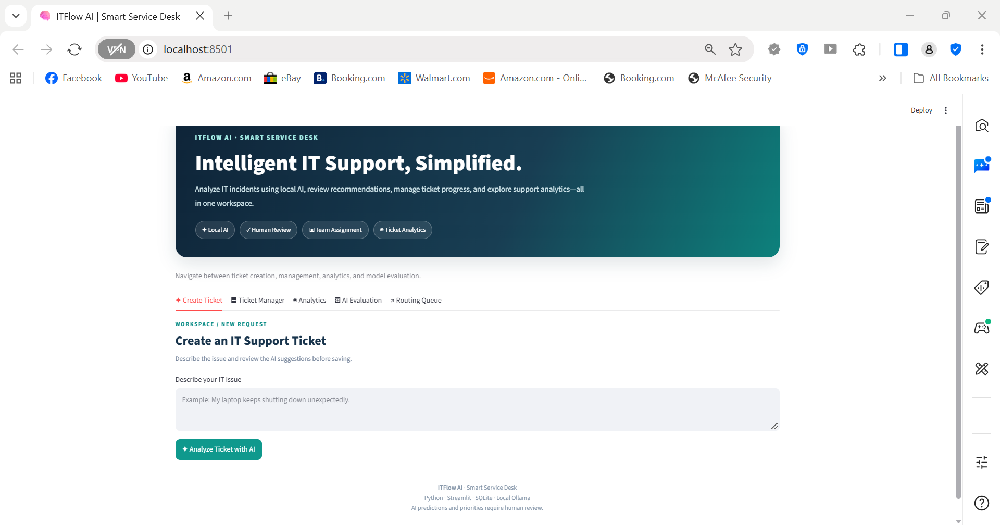
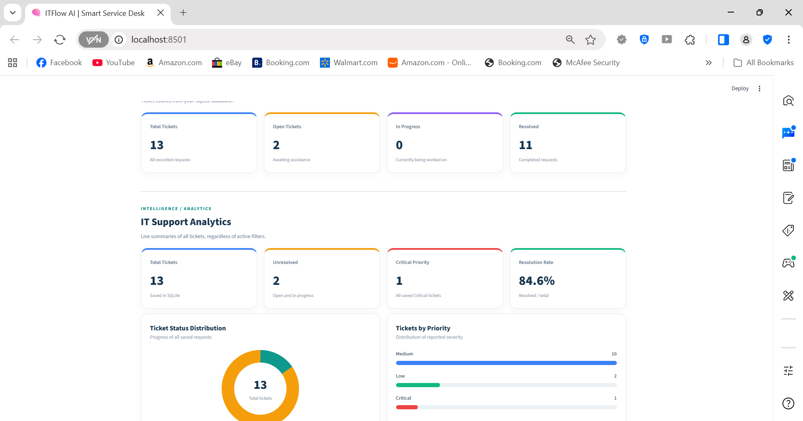
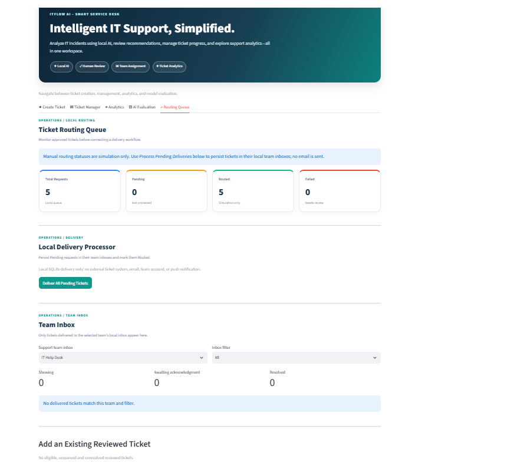

# ITFlow AI — Smart Service Desk

An AI-powered IT support ticket management application built with **Python, Streamlit, SQLite, and Ollama**.

ITFlow AI uses a locally running large language model (LLM) to classify IT support requests, recommend ticket priorities, and assign requests to appropriate IT support teams. Human approval is required before tickets are saved and routed.

## Features

- **AI-Powered Classification:** Uses Ollama's `qwen3:0.6b` model to classify support tickets by category and priority.
- **Human-in-the-Loop Review:** Allows users to confirm or correct AI recommendations before saving.
- **Ticket Management:** Search, filter, update, and resolve support tickets.
- **SQLite Database:** Stores tickets, approval history, corrections, and routing information.
- **Ticket Routing Queue:** Automatically queues approved tickets for processing.
- **Local Delivery Processor:** Delivers Pending tickets into persistent SQLite team inboxes.
- **Team Inbox:** Displays tickets assigned to specific support teams.
- **Ticket Acknowledgment:** Allows a team member to acknowledge a delivered ticket and move it to In Progress.
- **Resolution Tracking:** Records resolution notes and delivery activity.
- **Analytics Dashboard:** Displays ticket distribution, priorities, assignments, and resolution progress.
- **AI Evaluation:** Tests classification on five predefined sample cases.

## Application Screenshots

### AI Ticket Classification



### Analytics Dashboard



### Team Inbox



## Technology Stack

| Technology | Purpose |
|---|---|
| Python | Application logic |
| Streamlit | Web interface |
| SQLite | Local database |
| Ollama | Local LLM execution |
| Qwen3 0.6B | AI ticket classification |
| HTML/CSS | Interface styling |
| urllib | Communication with the local Ollama API |

## Requirements

- Python 3.13 (or a compatible Python version)
- Streamlit
- Ollama
- Ollama model: `qwen3:0.6b`

## Installation

**Step 1: Download or clone the repository.**

Open the project folder in Visual Studio Code.

**Step 2: Install the required Python packages.**

Open PowerShell in the project folder and run:

```powershell
py -3.13 -m pip install -r requirements.txt
```

**Step 3: Download the Ollama AI model.**

```powershell
ollama pull qwen3:0.6b
```

**Step 4: Ensure Ollama is running.**

Ollama must be available locally for AI ticket classification.

**Step 5: Start the application.**

```powershell
py -3.13 -m streamlit run main.py
```

**Step 6: Open the application.**

Open the local URL displayed in the terminal, typically:

`http://localhost:8501`

The ticket management and database features can work without Ollama, but AI classification requires the local model.

## How It Works

1. An employee submits an IT support issue.
2. The local AI model recommends a category and priority.
3. A human reviews and approves the recommendation.
4. The ticket is saved to SQLite and added to the routing queue.
5. The local delivery processor places the ticket in its assigned team's inbox.
6. A team member acknowledges the ticket.
7. The ticket moves to In Progress.
8. The issue is resolved and a resolution note is recorded.
9. The application updates its ticket records and analytics.

## Example Workflow

**Submitted Issue:** My laptop screen is broken, and I cannot use my computer.

| Field | Value |
|---|---|
| AI Classification | Hardware Issue |
| Priority | Medium |
| Assigned Team | IT Hardware |
| Routing Status | Pending → Routed |
| Ticket Status | Open → In Progress → Resolved |

**Workflow explanation:**

The AI identifies the issue as a hardware problem and recommends Medium priority. After human approval, the ticket enters the routing queue.

The local delivery processor places the ticket in the IT Hardware team's inbox.

A team member acknowledges the ticket, changing its status to In Progress. After completing the work, the team records a resolution note and marks the ticket as Resolved.

## Data Storage

The application uses a local SQLite database named `tickets.db`.

The database is automatically created when the application starts. It stores:

- Ticket descriptions and classifications
- Approved categories and priorities
- Ticket status changes
- Human review and correction history
- Routing requests
- Team inbox deliveries
- Acknowledgment and resolution records
- Delivery event history

The `tickets.db` file is excluded from the GitHub repository using `.gitignore` to prevent publishing private ticket information.

## Project Limitations

- The application is a local prototype, not a production service desk.
- Ticket delivery occurs inside SQLite; no external email or notifications are sent.
- Team inbox selection does not provide authenticated user access.
- The delivery processor must be triggered manually.
- Manually changing a routing status to Routed does not constitute actual local delivery.
- AI accuracy testing uses five predefined examples and does not establish real-world model reliability.
- The application does not currently support production-level security, service-level agreements, or automatic background processing.

## Future Improvements

- ServiceNow or Jira integration
- Microsoft Teams or email notifications
- Role-based user authentication
- Automatic background ticket processing
- SLA monitoring and escalation
- Larger AI evaluation datasets

## Project Type

**Personal Portfolio Project — AI-Powered IT Support Automation**

Developed to demonstrate practical skills in Python programming, local AI integration, SQL databases, ticket management workflows, and dashboard development.

## Project Files and Required Packages

The following files are used to run, document, and manage the ITFlow AI application.

| File | Description |
|---|---|
| `main.py` | Contains the main Python code for AI classification, ticket management, routing, and analytics. |
| `README.md` | Explains the project's features, setup instructions, and functionality. |
| `requirements.txt` | Lists the required Python packages. The application requires `streamlit>=1.32,<2`. |
| `.gitignore` | Tells Git which files and folders should not be tracked or uploaded to the repository, including the local ticket database, cache files, and virtual environments. |
| `tickets.db` | Stores ticket information, routing records, and resolution history locally. This file is excluded from GitHub. |

### Required Package

The application's required external Python package is **Streamlit**, specified in `requirements.txt` as:

```text
streamlit>=1.32,<2
```

This means Streamlit version 1.32 or newer is required, but versions 2.0 and above are excluded.

Other modules, including `sqlite3`, `json`, `datetime`, and `urllib`, are provided by Python's standard library.

Ollama and the `qwen3:0.6b` AI model are installed separately.

### Git Ignore Configuration

The `.gitignore` file tells Git which local files and folders should not be tracked.

It excludes:

- The local SQLite ticket database
- Python cache files
- Virtual environments
- Environment configuration files
- Editor-specific settings

This helps keep the repository organized and prevents accidental publication of locally stored ticket records.
